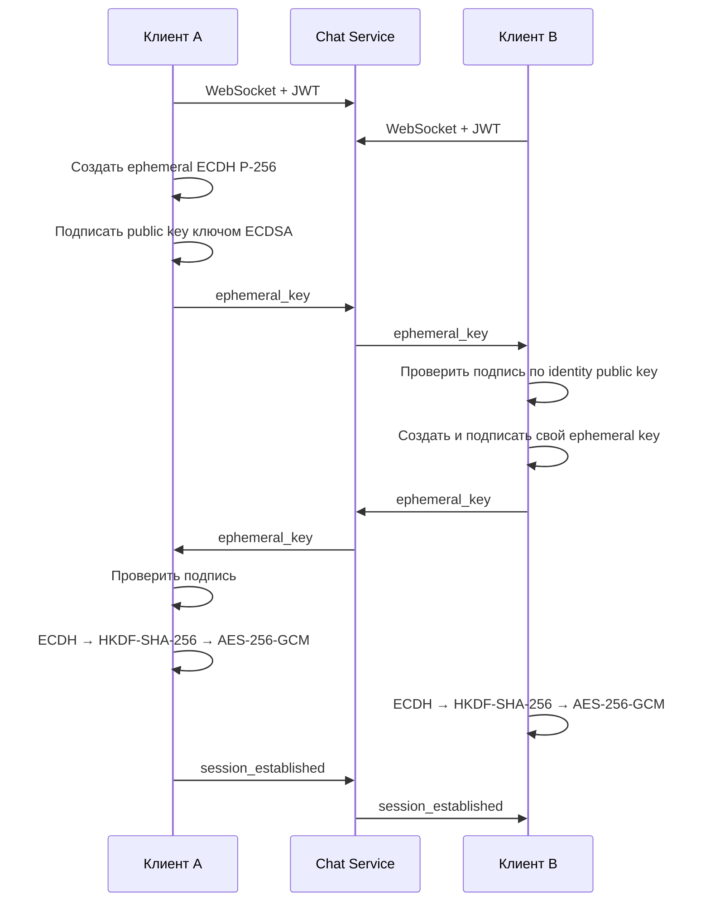

# DH Secure Chat

Защищённый браузерный мессенджер для общения один на один. Текст, файлы, голосовые и видеосообщения шифруются на стороне отправителя и расшифровываются только в браузере получателя. Сервер отвечает за регистрацию, авторизацию, поиск пользователей и доставку данных по WebSocket, но не получает ключ сессии.

## Возможности

- регистрация и вход по имени пользователя и паролю;
- поиск пользователей и личные чаты один на один;
- обмен сообщениями в реальном времени через WebSocket;
- статусы `sending`, `delivered` и `read`;
- ответы, редактирование, удаление и реакции;
- индикаторы набора текста, записи голоса и видео;
- передача файлов размером до 50 МБ;
- голосовые сообщения до 5 минут и 10 МБ;
- видеосообщения и превью медиафайлов;
- режимы доступа к файлам: просмотр, скачивание или оба варианта;
- визуальная проверка fingerprint собеседника;
- метрики Prometheus и готовый дашборд Grafana.

## Быстрый старт

Для запуска нужны Git, Docker и Docker Compose.

```bash
git clone https://github.com/AlibekovAA/dh-secure-chat.git
cd dh-secure-chat
cp infra/env.example .env
docker compose -f docker-compose.dev.yml up --build
```

На Windows без `make` используется та же команда `docker compose`. Если `make` установлен, можно выполнить:

```bash
make up
```

После запуска откройте:

- `https://localhost` — приложение по HTTPS;
- `http://localhost` — перенаправление на HTTPS;
- `http://localhost:8081/health` — состояние Auth Service;
- `http://localhost:8082/health` — состояние Chat Service.

Локальный сертификат находится в `infra/proxy/certs`. Браузер может предупредить, что сертификат разработчика не является доверенным. HTTPS необходим для стабильной работы Web Crypto API и браузерных Media API.

Остановка dev-стека:

```bash
docker compose -f docker-compose.dev.yml down
```

или:

```bash
make down
```

## Переменные окружения

Создайте `.env` из файла `infra/env.example`:

```dotenv
POSTGRES_USER=dhchat
POSTGRES_PASSWORD=dhchat
POSTGRES_DB=dhchat
JWT_SECRET=replace-with-a-random-secret-at-least-32-bytes
LOG_DIR=/var/log/dh-secure-chat
LOG_LEVEL=INFO
```

## Как устроен проект

```text
Browser
  │ HTTPS / WSS
  ▼
Nginx
  ├── Frontend: React SPA
  ├── Auth Service: регистрация, вход и токены
  └── Chat Service: пользователи, identity API и WebSocket
          │
          ▼
      PostgreSQL
```

- **Frontend** генерирует ключи, устанавливает защищённую сессию и шифрует содержимое сообщений и файлов.
- **Auth Service** создаёт пользователей, проверяет пароли, выдаёт access token и управляет refresh token.
- **Chat Service** обслуживает REST API чата, identity API и WebSocket-соединения.
- **PostgreSQL** хранит пользователей, публичные identity-ключи и серверные данные авторизации.
- **Nginx** раздаёт frontend, завершает HTTPS и маршрутизирует запросы к backend.
- **Prometheus и Grafana** подключаются только в полном стеке.

Identity API является частью процесса Chat Service, а не отдельным контейнером.

## Защищённая сессия

Для identity и каждой сессии используются разные ключи.

### Identity-ключ

При регистрации браузер создаёт долгоживущую пару **ECDSA P-256**:

- публичный ключ экспортируется и сохраняется на сервере;
- приватный ключ сохраняется в IndexedDB как неэкспортируемый `CryptoKey`;
- приватный ключ не отправляется на сервер и используется для подписи временных ключей.

Приватный identity-ключ привязан к конкретному профилю браузера. Очистка данных сайта или вход с нового устройства создаёт новый ключ и обновляет публичный ключ пользователя на сервере.

### Установка сессии



Для каждого открытия чата клиенты создают временные пары **ECDH P-256**. Их публичные части подписываются identity-ключами. После проверки подписи обе стороны независимо получают общий секрет через ECDH и выводят из него сессионный ключ **AES-256-GCM** через **HKDF-SHA-256**.

Обмен `ephemeral_key` подтверждается сообщениями `ack` и повторяется при отсутствии подтверждения. Сервер только проверяет структуру и маршрутизирует сообщения между подключёнными пользователями.

### Шифрование данных

- текст кодируется в браузере и шифруется AES-256-GCM;
- для каждой операции создаётся отдельный 12-байтовый nonce;
- файлы разбиваются на части по 1 МБ, каждая часть шифруется отдельно;
- получатель проверяет метаданные, порядок, размер и полноту частей перед сборкой файла;
- сервер видит служебные поля маршрутизации, ciphertext и nonce, но не ключ сессии и открытое содержимое.

Fingerprint — это SHA-256 от публичного identity-ключа. Пользователи могут сравнить его вне приложения и отметить identity собеседника как проверенный. Это снижает риск подмены ключа, но не заменяет независимую проверку личности.

## Ограничения безопасности

Проект демонстрирует клиентское шифрование, но ещё не проходил независимый аудит. Важно учитывать:

- приватный identity-ключ хранится только в текущем профиле браузера;
- история сообщений постоянно на сервере не хранится;
- метаданные соединения и доставки доступны серверу;
- безопасность зависит от целостности frontend-кода, который отдаёт сервер;
- режим `view_only` ограничивает действия интерфейса, но не может гарантировать защиту от снимков экрана или модифицированного клиента;

## Технологии

### Frontend

- React 18;
- TypeScript 5.9;
- Vite 6;
- Tailwind CSS 4;
- Web Crypto API;
- WebSocket, MediaRecorder и IndexedDB;
- ESLint 10 и Prettier 3.

Требования для локального запуска frontend без Docker:

- Node.js `^22.22.2` или `>=24.15.0`;
- npm `>=12.2.0`.

### Backend

- Go 1.24;
- стандартный `net/http`;
- Gorilla WebSocket;
- PostgreSQL 16 и pgx;
- JWT;
- Prometheus client.

### Инфраструктура

- Docker Compose;
- Nginx;
- Prometheus;
- Grafana.

## Команды разработки

### Docker Compose

```bash
make up          # dev-стек: приложение и база данных
make down        # остановить dev-стек
make prod-up     # полный стек с Prometheus и Grafana
make prod-down   # остановить полный стек
make help        # показать команды Makefile
```

`make clean` останавливает и удаляет все Docker-контейнеры, образы и volumes в системе.

### Frontend без Docker

```bash
cd frontend
npm install
npm run dev
```

Доступные проверки:

```bash
npm run type-check
npm run lint
npm run format:check
npm run build
```

### Backend без Docker

Для backend нужны Go 1.24, запущенный PostgreSQL и настроенные переменные окружения.

```bash
make backend
```

Команда запускает Auth Service и Chat Service. На Windows поведение фонового оператора `&` зависит от используемой оболочки, поэтому надёжнее запускать сервисы в отдельных терминалах:

```bash
cd backend
go run ./cmd/auth
```

```bash
cd backend
go run ./cmd/chat
```

## REST API

Все защищённые REST-запросы используют `Authorization: Bearer <access-token>`. Refresh token хранится в cookie `refresh_token` с флагами `HttpOnly` и `SameSite=Strict`; флаг `Secure` включается при HTTPS.

### Auth Service

| Метод  | Endpoint             | Назначение                                                |
| ------ | -------------------- | --------------------------------------------------------- |
| `POST` | `/api/auth/register` | Регистрация пользователя и сохранение identity public key |
| `POST` | `/api/auth/login`    | Вход и выдача новой пары токенов                          |
| `POST` | `/api/auth/refresh`  | Ротация refresh token и выдача access token               |
| `POST` | `/api/auth/logout`   | Отзыв токенов и удаление refresh cookie                   |
| `POST` | `/api/auth/revoke`   | Отзыв текущего access token                               |

### Chat и Identity API

| Метод  | Endpoint                                 | Назначение                                                                     |
| ------ | ---------------------------------------- | ------------------------------------------------------------------------------ |
| `GET`  | `/api/chat/me`                           | Текущий пользователь                                                           |
| `GET`  | `/api/chat/users?username=...&limit=...` | Поиск пользователей                                                            |
| `GET`  | `/api/chat/users/{id}/identity-key`      | Identity public key пользователя для установки сессии                          |
| `GET`  | `/api/identity/users/{id}/key`           | Identity public key пользователя                                               |
| `GET`  | `/api/identity/users/{id}/fingerprint`   | Fingerprint identity-ключа                                                     |
| `POST` | `/api/identity/update-public-key`        | Замена собственного identity public key после создания нового локального ключа |

Сервисы также предоставляют `GET /health` и `GET /metrics` на портах 8081 и 8082.

## WebSocket-протокол

Подключение выполняется к `WSS /ws/`. Авторизация возможна заголовком `Authorization` или первым сообщением типа `auth`.

Основные типы сообщений:

| Тип                   | Назначение                                       |
| --------------------- | ------------------------------------------------ |
| `auth`                | Авторизация WebSocket-соединения                 |
| `ephemeral_key`       | Обмен подписанными временными публичными ключами |
| `session_established` | Подтверждение готовности защищённой сессии       |
| `message`             | Зашифрованное текстовое сообщение                |
| `ack`                 | Подтверждение получения                          |
| `message_read`        | Статус прочтения                                 |
| `message_edit`        | Редактирование сообщения                         |
| `message_delete`      | Удаление сообщения                               |
| `reaction`            | Добавление или удаление реакции                  |
| `typing`              | Активность пользователя: текст, голос или видео  |
| `file_start`          | Метаданные передачи файла                        |
| `file_chunk`          | Зашифрованная часть файла                        |
| `file_complete`       | Завершение передачи файла                        |
| `peer_offline`        | Собеседник не подключён                          |
| `peer_disconnected`   | Собеседник отключился                            |
| `error`               | Структурированная ошибка протокола               |

Backend валидирует типы, размеры и адресатов сообщений, ограничивает число одновременных передач и отслеживает состояние файловой передачи. Содержимое сообщений и файлов остаётся зашифрованным.

## Мониторинг

Полный стек запускается командой:

```bash
make prod-up
```

После запуска доступны:

- Prometheus: `http://localhost:9090`;
- Grafana: `http://localhost:3000`;
- стандартный вход Grafana для локальной разработки: `admin` / `admin`.

Готовый дашборд показывает HTTP-запросы, WebSocket-соединения, ошибки, задержки, состояние очереди, пул PostgreSQL, circuit breaker, токены и передачу файлов.

## Тестирование

Backend-тесты находятся в `backend/test`:

```bash
make backend-test
```

или:

```bash
cd backend
go test -count=1 ./test/...
```

Для frontend используются статические проверки и production-сборка:

```bash
cd frontend
npm run type-check
npm run lint
npm run format:check
npm run build
```

## Структура репозитория

```text
backend/                 Go-сервисы и backend-тесты
frontend/                React-приложение
infra/                   Nginx, сертификаты, PostgreSQL, Prometheus и Grafana
yaml/                    Compose-фрагменты отдельных сервисов
docker-compose.dev.yml   Dev-стек
docker-compose.yml       Полный стек с мониторингом
Makefile                 Основные команды разработки
```
